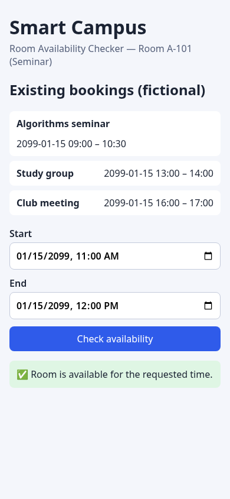

# Smart Campus – Room Availability Checker

**Live demo:** https://comalonwizme.github.io/smart-campus-room-checker/

Single fictional room, fictional bookings, no login, no database.

## Run
```
npm install
npm run dev
npm test
npm run build
```

## Acceptance contract
- AC1 reject invalid input
- AC2 reject past times
- AC3 duration 30–120 min
- AC4 reject overlap with an existing booking
- AC5 reject requests for a blocked room
- AC6 stored booking data is never mutated by a check
- AC7 (UI) clear availability feedback; usable on desktop and mobile

## Practice #10 — AI risk review (Lesson 10)
Deliverables (all in this repo):
| Task | File |
|------|------|
| #01 baseline | git tag `baseline`, `evidence/01-*` |
| #02 AI read-only review / #03 challenge findings | `docs/ai-review.md`, `docs/risk-register.md` |
| #04 risk register (8 risks, top two ranked) | `docs/risk-register.md` |
| #05/#06 readiness audit + AGENTS.md review | `docs/agents-audit.md`, `AGENTS.md` |
| #07 verification (before/after, UI check) | `evidence/`, `screenshots/`, `scripts/screenshots.mjs` |
| #08 two mitigations | `src/lib/availability.ts`, `tests/regression.test.ts` |
| #09 background agent + optional checklist | `docs/background-agent-plan.md` |
| Release decision | `docs/release-decision.md` |

> Note: the original Practice #09 Bolt.new project was unavailable; this baseline was rebuilt from the same acceptance contract.

Screenshots:  

### AI chat sessions (Tasks #02, #06, optional checklist)
The three slide prompts were sent to separate, read-only Claude Code sessions (`claude -p`, model `claude-opus-5-5`, tools limited to Read/Grep/Glob) run against the `baseline` tag. Responses are verbatim:
- Transcripts: `docs/ai-chats/`
- Screenshots: `screenshots/ai-chats/` (`*-top.png` = first screen, others = full response)
