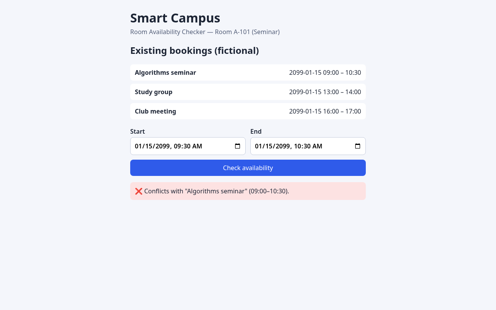
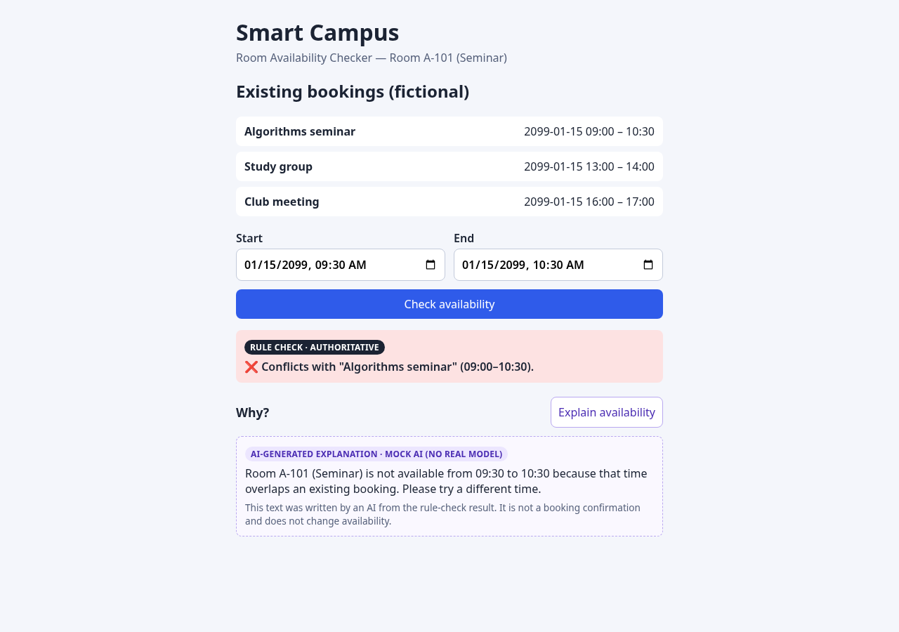
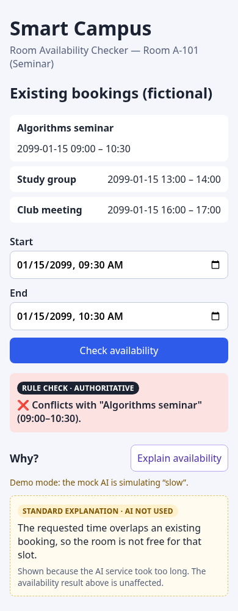

# Smart Campus – Room Availability Checker

**Live demo:** https://comalonwizme.github.io/smart-campus-room-checker/

Single fictional room, fictional bookings, no login, no database.

## Run
```
npm install
npm run dev
npm test
npm run build
```

## Acceptance contract
- AC1 reject invalid input
- AC2 reject past times
- AC3 duration 30–120 min
- AC4 reject overlap with an existing booking
- AC5 reject requests for a blocked room
- AC6 stored booking data is never mutated by a check
- AC7 (UI) clear availability feedback; usable on desktop and mobile

## Practice #10 — AI risk review (Lesson 10)
Deliverables (all in this repo):
| Task | File |
|------|------|
| #01 baseline | git tag `baseline`, `evidence/01-*` |
| #02 AI read-only review / #03 challenge findings | `docs/ai-review.md`, `docs/risk-register.md` |
| #04 risk register (8 risks, top two ranked) | `docs/risk-register.md` |
| #05/#06 readiness audit + AGENTS.md review | `docs/agents-audit.md`, `AGENTS.md` |
| #07 verification (before/after, UI check) | `evidence/`, `screenshots/`, `scripts/screenshots.mjs` |
| #08 two mitigations | `src/lib/availability.ts`, `tests/regression.test.ts` |
| #09 background agent + optional checklist | `docs/background-agent-plan.md` |
| Release decision | `docs/release-decision.md` |

> Note: the original Practice #09 Bolt.new project was unavailable; this baseline was rebuilt from the same acceptance contract.

Screenshots:  

### AI chat sessions (Tasks #02, #06, optional checklist)
The three slide prompts were sent to separate, read-only Claude Code sessions (`claude -p`, model `claude-opus-5-5`, tools limited to Read/Grep/Glob) run against the `baseline` tag. Responses are verbatim:
- Transcripts: `docs/ai-chats/`
- Screenshots: `screenshots/ai-chats/` (`*-top.png` = first screen, others = full response)

## Practice #11 — AI-enabled feature: "Explain availability" (Lesson 11)
After a rule check, **Explain availability** shows a short, student-friendly explanation. The rule engine stays the only source of truth. The explanation is generated by a clearly labelled **mock LLM adapter** (no API key, no network), checked against the decision, and replaced by a fixed template if the model times out, fails or says something unsupported.

Try the failure modes on the live demo: `?mock=slow` (timeout), `?mock=error` (API failure), `?mock=contradict`, `?mock=malformed`.

| Task | Deliverable |
|------|-------------|
| #01 baseline | git tag `practice11-baseline`; `evidence/p11/01-*` (14/14 tests, build OK, `tsc` clean; no lint script exists) |
| #02 feature contract + flow diagram | `docs/practice-11/feature-contract.md` |
| #03 build with an AI assistant | `src/lib/explain/` (contract, prompt, mock adapter, orchestrator), `src/App.tsx` |
| #04 prompt engineering (3 prompts, real model) | `docs/practice-11/prompt-comparison.md`, `scripts/compare-prompts.ts`, `docs/practice-11/prompt-runs.json` |
| #05 normal + failure tests (expected vs observed) | `docs/practice-11/test-report.md`, `tests/explain.test.ts`, `scripts/p11-screenshots.mjs`, `screenshots/p11/` |
| #06 agentic code review | `docs/practice-11/ai-chats/agentic-review.md` (verbatim), `docs/practice-11/agentic-review.md` (findings evaluated vs `manual-review.md`) |
| #07 repair + regression | `docs/practice-11/repair-log.md`, `evidence/p11/07-*` |
| Discussion / reflection | `docs/practice-11/discussion.md`, `docs/practice-11/reflection.md` |

Results: 78/78 tests (14 original + 64 feature), build OK, 13/13 UI scenarios with the decision unchanged after "Explain". The rule files have no diff against `practice11-baseline`.

 
