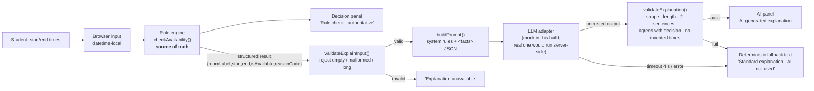

# Task #02 — Feature contract: "Explain availability"

## User story
> As a **student**, I want a **short explanation of room availability** so that I **understand the decision**.

The explanation is optional and secondary. The rule engine (`checkAvailability` in `src/lib/availability.ts`) is the only thing that decides availability. The LLM never decides availability, never sees or changes bookings, and never books anything.

## Architecture and trust boundary



Written flow (same thing, for readers without Mermaid):

```
student input → rule engine (decides) → decision panel
                     │
                     └─ structured result → input validation → prompt → [LLM adapter] → output validation → AI panel
                                               │ invalid                     │ timeout/error    │ invalid
                                               ▼                             ▼                  ▼
                                        "unavailable" msg            deterministic fallback text
```

**Where the boundary is.** Everything to the right of the rule engine is advisory. Nothing that the adapter returns flows back into `checkAvailability`, `BOOKINGS` or the decision panel.

**Secrets.** This build uses a mock adapter that runs in the browser and needs no key. A real adapter must run on a server: the browser would send only the validated `ExplainInput` to the server, and the server would hold the API key, call the model and run `validateExplanation` again before replying. No key, no booking titles and no personal data are ever sent to the browser or to the model.

## Input contract (`ExplainInput`, `src/lib/explain/contract.ts`)

| Field | Type | Rule |
|---|---|---|
| `roomLabel` | string | 1–60 chars after trim; letters, digits, spaces and `( ) . , - – / #` only |
| `start`, `end` | `"YYYY-MM-DDTHH:MM"` or `null` | real calendar time (`parseLocal`); max 16 chars; `null` allowed only for `reasonCode: INVALID` |
| `isAvailable` | boolean | must equal `reasonCode === "OK"` |
| `reasonCode` | `OK \| INVALID \| PAST \| DURATION \| BLOCKED \| OVERLAP \| DATA_ERROR` | exactly the checker's codes |
| any other key | — | **rejected** (stops booking titles or personal data being added later by mistake) |

Booking titles, booking ids and the checker's human message are deliberately **not** part of the input ("minimal context").

## Output contract (`ExplainOutput`)

`{ "explanation": string }`, and nothing else. `validateExplanation` accepts it only if:

1. it is an object with exactly one key, `explanation`, of type string;
2. after whitespace normalisation it is 10–280 characters and at most **two sentences**;
3. it contains no markup, code fences, braces or links;
4. it does not claim an action ("booking confirmed", "I reserved…");
5. it **agrees with the decision**: no "unavailable / overlaps / blocked …" wording when `isAvailable` is true, and no "is available / is free / you can book" wording when it is false;
6. every clock time (`HH:MM`) and date (`YYYY-MM-DD`) it mentions appears in the input (no invented booking details).

## Acceptance criteria

| AC | Criterion | How it is enforced | Test |
|---|---|---|---|
| AC1 | Existing availability and overlap rules remain unchanged | `availability.ts`, `bookings.ts` and the old tests are untouched (`git diff practice11-baseline` = 0 lines); the feature only reads the result | old 14 tests; TC13 |
| AC2 | Explanation agrees with the deterministic result; no invented booking details | output validator rules 5–6; booking titles never sent | TC01–TC05, TC10b, TC11, TC12 |
| AC3 | Empty, malformed or overly long input is rejected | `validateExplainInput` runs before any adapter call | TC06, TC07 (adapter spy never called) |
| AC4 | Timeout, API error or unavailable key → safe fallback | 4 s timeout + `AbortController`; any throw → fallback; fallback text is a fixed template per reason code | TC08, TC09, TC10 |
| AC5 | User can tell a generated explanation from the confirmed booking status | separate panels and labels: "Rule check · authoritative" vs "AI-generated explanation · Mock AI" vs "Standard explanation · AI not used"; disclaimer under the AI text | UI check (screenshots), TC13 |

## Failure behaviour

| Situation | What the user sees | Decision panel |
|---|---|---|
| Input fails validation | Yellow "Explanation unavailable" box with the reason | unchanged |
| Model does not answer within 4 s | Fixed template text, labelled "Standard explanation · AI not used", "the AI service took too long" | unchanged |
| Adapter throws (HTTP error, missing key, network) | Same fallback, "the AI service is unavailable" | unchanged |
| Model output is malformed, too long, contradicts the decision or invents a time | Same fallback, "the AI answer failed our safety checks" | unchanged |
| User runs a new check while an explanation is loading | Old request is aborted; its answer is discarded | shows the new result |

## Out of scope (unchanged from AGENTS.md)
One fictional room, fictional bookings, no login, no database, no real personal data, no client-side secrets, no real network calls in this build.
